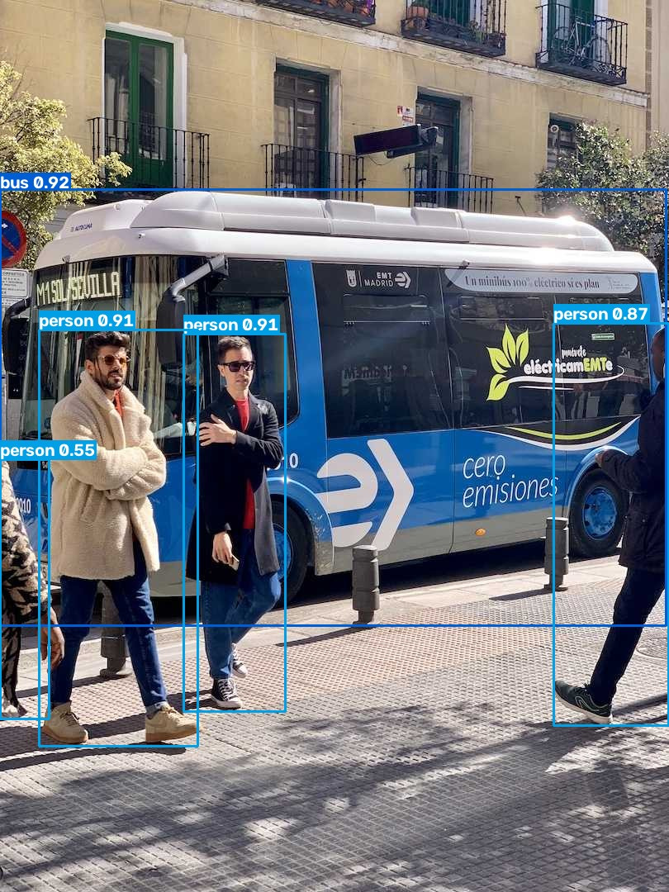
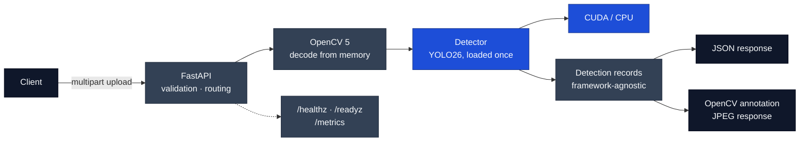

# YOLO26 Inference Service

Object detection over HTTP. A YOLO26 model behind a FastAPI service, with OpenCV 5 for
decoding and annotation, packaged to run in a container.

The model call is the easy part. What makes a detector *deployable* is everything around
it: loading weights once instead of per request, telling an orchestrator the difference
between "the process is up" and "the model is ready", refusing malformed uploads before
they reach the GPU, and being honest about latency at the tail rather than the mean.



## Quickstart

```bash
# 1. PyTorch first, from the index matching your hardware.
#    PyPI serves a CPU-only build, which silently ignores an available GPU.
pip install --index-url https://download.pytorch.org/whl/cu126 torch torchvision   # NVIDIA
# pip install torch torchvision                                                    # CPU

# 2. Everything else
pip install -r requirements.txt

# 3. Run
PYTHONPATH=src uvicorn vision.service:app --port 8000
```

```bash
curl -X POST http://localhost:8000/detect -F "file=@data/bus.jpg"
```

```json
{
  "detections": [
    { "x1": 0.0, "y1": 229.4, "x2": 806.1, "y2": 757.1,
      "confidence": 0.924, "class_id": 5, "class_name": "bus" },
    { "x1": 222.5, "y1": 404.9, "x2": 345.4, "y2": 861.7,
      "confidence": 0.913, "class_id": 0, "class_name": "person" }
  ],
  "count": 5,
  "inference_ms": 9.69,
  "image": { "width": 810, "height": 1080 },
  "model": "yolo26n.pt",
  "device": "cuda:0"
}
```

## Architecture



The HTTP layer never imports `ultralytics`. It works with plain `Detection` records, which
is why the entire request path — validation, routing, error handling, annotation — is
testable without a model, a GPU, or a network connection.

## API

| Method | Path | |
|---|---|---|
| `POST` | `/detect` | Image upload → detections as JSON |
| `POST` | `/detect/annotated` | Image upload → JPEG with boxes drawn |
| `GET` | `/classes` | The 80 COCO classes this model detects |
| `GET` | `/healthz` | Liveness — answers as soon as the process is up |
| `GET` | `/readyz` | Readiness — 503 until the model is loaded and warm |
| `GET` | `/metrics` | Request counts and latency percentiles |
| `GET` | `/docs` | OpenAPI documentation, generated by FastAPI |

`/healthz` and `/readyz` are deliberately different endpoints. A container is alive long
before it can serve a prediction, and an orchestrator that cannot tell those apart will
either route traffic to a cold replica or kill one that was still loading.

## Measured performance

Measured on this machine, not estimated. `yolo26n.pt` at `imgsz=640`, on an 810 × 1080
photograph. Warmup iterations discarded.

| | RTX 4060 (8 GB) | i7-14700F (CPU) |
|---|---|---|
| **p50** | **8.10 ms** | 29.96 ms |
| p90 | 16.09 ms | 41.81 ms |
| p99 | 18.95 ms | 45.43 ms |
| mean | 9.84 ms | 32.00 ms |
| **throughput** | **99.0 img/s** | 31.2 img/s |
| runs | 100 (10 warmup) | 50 (5 warmup) |

About **3.7× faster at p50** on the GPU. Reproduce with:

```bash
python tools/benchmark.py --device cuda:0 --image data/bus.jpg --runs 100
python tools/benchmark.py --device cpu    --image data/bus.jpg --runs 50
```

Percentiles rather than a mean, because a mean hides the tail and the tail is what a
caller actually experiences. Note p99 is more than twice p50 even on the GPU.

## Design notes

**The model loads at startup, not on first request.** Loading takes seconds, and the first
CUDA call in a process additionally pays for kernel compilation. Left to happen lazily,
that entire cost lands on whichever unlucky user arrives first. The service loads and runs
blank warmup inferences before it reports ready.

**Uploads are decoded in memory.** `cv2.imdecode` on a byte buffer, never a temporary
file, so user-supplied data is never written to disk. Anything over 20 MB is rejected
before decoding.

**One model instance, shared.** Inference is GPU-bound; several model copies would compete
for the same device and make the tail worse, not better.

**Labels stay inside the frame.** A box against the top edge would otherwise have its label
drawn at negative *y* and clipped away — visible on the `bus` label in the image above,
which is drawn inside its box rather than above it.

**Metrics are per-process and in-memory.** Honest about its own limits: behind several
replicas each reports only its own view. That is the point at which a real metrics backend
earns its place, and this deliberately does not pretend to be one.

## Docker

```bash
docker compose -f docker/compose.yaml up --build          # CPU
docker compose -f docker/compose.yaml --profile gpu up    # NVIDIA, needs the Container Toolkit
```

The CPU image is multi-stage, runs as an unprivileged user on a read-only filesystem, and
uses `opencv-python-headless` — the service never opens a window, so the GUI stack and its
`libGL` dependencies are dead weight. Weights are baked in at build time so a cold start
does not depend on reaching the internet.

The healthcheck polls `/readyz`, not `/healthz`, with a `start-period` long enough to
cover model loading.

## ONNX export

```bash
python tools/export_onnx.py --model yolo26n.pt --imgsz 640
```

ONNX decouples deployment from PyTorch: the graph runs under ONNX Runtime on machines with
no torch install and no CUDA. The export is **verified rather than assumed** — Ultralytics
reports success as soon as it has written a file, so the tool loads the result back through
ONNX Runtime and runs an inference before declaring it good.

Verified output: `yolo26n.onnx`, 9.5 MB, input `images [1, 3, 640, 640]`, output
`(1, 300, 6)`.

## Tests

```bash
pytest tests/ -v
```

22 tests, running in under a second. None download weights, load a model, or need a GPU —
the detector is injected through FastAPI's dependency system. Coverage includes image
decode failures, the oversized-upload guard, annotation not mutating its input, latency
percentiles, configuration validation, and the 503 paths taken while the model is still
loading.

## Configuration

Every setting has a working default; the service starts with no configuration at all.

| Variable | Default | |
|---|---|---|
| `VISION_MODEL` | `yolo26n.pt` | Weights: `n` / `s` / `m` / `l` / `x`, or a path |
| `VISION_DEVICE` | auto | `cuda:0`, `cpu`, `mps` |
| `VISION_CONFIDENCE` | `0.25` | Confidence threshold |
| `VISION_IOU` | `0.45` | NMS IoU threshold |
| `VISION_IMAGE_SIZE` | `640` | Inference size, multiple of 32 |
| `VISION_MAX_DETECTIONS` | `300` | Cap on detections per image |
| `VISION_WARMUP_ITERATIONS` | `2` | Blank inferences run at startup |
| `VISION_EAGER_LOAD` | `true` | Load the model at startup |

## Versions

Built and verified against, as of August 2026:

| | |
|---|---|
| OpenCV | 5.0.0 |
| Ultralytics | 8.4.117 |
| PyTorch | 2.13.0+cu126 |
| FastAPI | 0.141.1 |
| ONNX Runtime | 1.28.0 |
| Python | 3.13 |

## Limits

- Single-image requests only. There is no batching endpoint, so throughput under
  concurrent load will be lower than the benchmark's sequential figure.
- Metrics are per-process, held in a bounded window, and reset on restart.
- No authentication. Put it behind a gateway before exposing it.
- Benchmarked on one machine with one image. Treat the numbers as indicative of this
  hardware, not as a general claim about YOLO26.

## Licence

**AGPL-3.0** — see [LICENSE](LICENSE).

This is not a free choice. Ultralytics YOLO is AGPL-3.0, and the AGPL extends to software
that users interact with *over a network* — which is precisely what this service is.
Licensing it permissively would misrepresent the obligations that come attached.

If you need to run this in a closed-source product, you need a
[commercial licence from Ultralytics](https://www.ultralytics.com/license). Swapping in a
differently-licensed model is the other way out, and the detector abstraction is where
you would do it.
