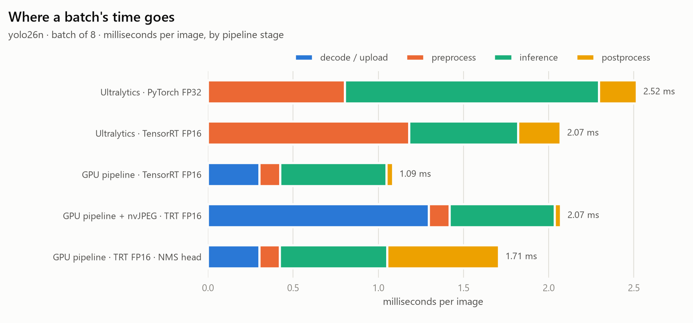
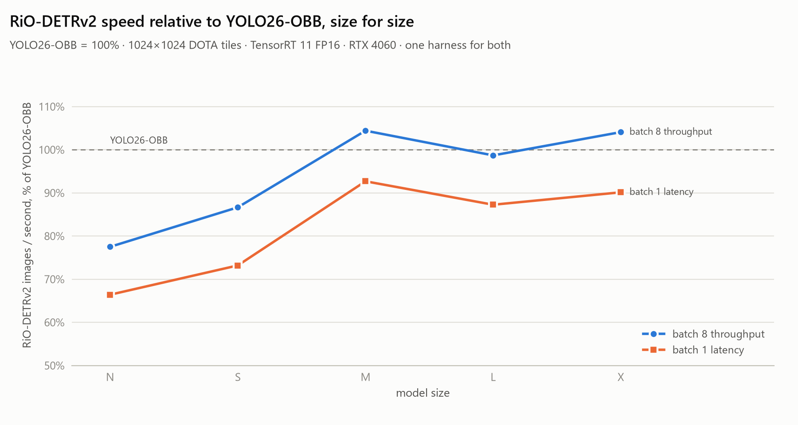
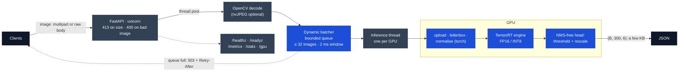

# YOLO26 Inference Service

Object detection over HTTP: YOLO26 on **TensorRT 11**, ONNX Runtime or PyTorch, behind a
FastAPI service with **dynamic batching**, a **GPU-resident pre/post-processing pipeline**,
load shedding, Prometheus metrics and NVML GPU telemetry, plus a benchmark suite that measures
every claim this README makes.

v1 answered "can this model be served?". v2 answers the questions a Solutions Architect is
actually asked: *which runtime, which precision, which model size, how many requests per GPU,
what does the tail look like under load, what does an image cost, and what does accuracy pay
for speed?* And, for aerial imagery: *does a 2026 real-time detection transformer beat YOLO26 on
oriented boxes?* Every number below was measured on one machine (an RTX 4060 desktop, specified
at the end of [docs/BENCHMARKS.md](docs/BENCHMARKS.md)); none is quoted from a vendor. The one
exception, DOTA accuracy for the oriented-box models, which only the official evaluation server
can score, is labelled where it appears.


yolo26n on TensorRT FP16, through the same GPU pipeline the service runs. Each frame's latency is
measured while it is rendered (pre-process, inference and post-process, median of 30 runs at
batch 1). Photos: COCO val2017, CC BY 2.0 ([credits](docs/media/CREDITS.md)); rendered by
`tools/make_media.py`.

## Results at a glance

Over real HTTP, with real uploads, one RTX 4060 now serves **968 requests/s at peak, 10.6× the
v1 service** (91.5) measured on the same machine, and **606 requests/s within a 50 ms p99, 6.7×
v1**. Each step that got there, and the bottleneck it moved, is in the chart and the table.

<picture>
  <source media="(prefers-color-scheme: dark)" srcset="docs/results/service-throughput.dark.png">
  
</picture>

| Service configuration (yolo26n, one RTX 4060) | Peak req/s | req/s within p99 ≤ 50 ms | p50, one request in flight | GPU util at peak | What capped it |
|---|---|---|---|---|---|
| v1: PyTorch, model run inside the async handler | 92 | 90 | 11.3 ms | 37% | One CPU core: inference blocks the event loop |
| v2: PyTorch on an inference thread | 119 | 119 | 10.7 ms | 38% | Batch-1 inference, one at a time |
| + TensorRT FP16 | 324 | 324 | 6.9 ms | 58% | Batch-1 inference, one at a time |
| + dynamic batching (≤ 32 images, 2 ms window) | 500 | 500 | 9.9 ms | 50% | The single event loop; GPU half idle |
| + raw-body upload (`/detect/raw`) | 528 | 528 | 9.8 ms | 54% | The single event loop |
| **+ 4 worker processes sharing the GPU** | **968** | **606** | 9.4 ms | 91% | The GPU |
| Batching + nvJPEG decode instead | 428 | 420 | 8.1 ms | 46% | Decode queued on the inference thread |

Batching is not free for a lone request: at one request in flight it adds 3 ms to the p50
(6.9 → 9.9 ms), 2.6 ms of it spent waiting out the batching window, and in exchange raises
peak throughput 1.5×.

| Question | Measured answer (yolo26n unless stated, RTX 4060) |
|---|---|
| Fastest runtime? | **TensorRT FP16: 908 img/s**, 2.4× PyTorch FP32 (384) and 3.2× ONNX Runtime CUDA (287) |
| Does FP16 cost accuracy? | No. COCO mAP50-95 **40.24 vs 40.26** at FP32, all 5,000 val2017 images |
| Does INT8 pay off? | **Only for larger models.** −9% throughput on yolo26n, **+63% on yolo26x**, for **2.4–5.4 mAP** |
| Is the model the bottleneck? | Not once it is on TensorRT. The stock predictor leaves the GPU **58% idle**; moving pre/post-processing onto the GPU **doubles throughput (442 → 907 img/s)** on the same engine |
| NMS-free head worth it? | Yes: **1.56× throughput** and **+0.6 mAP50-95** over the one-to-many head + NMS |
| Decode JPEGs on the GPU? | **Not on this card.** nvJPEG halves end-to-end throughput; 16 CPU threads decode 2.5× faster |
| GPU vs CPU? | 908 vs 76 img/s (**12×**) against the best CPU path (ONNX Runtime, i7-14700F) |
| How far does the HTTP service scale? | v1: **91.5 req/s**. v2: **968 req/s** (4 workers, one GPU); 606 within a 50 ms p99 |
| How many camera streams per GPU? | Within a 50 ms p99: **20 at 30 fps**, 40 at 15 fps, 121 at 5 fps |
| Lowest single-image latency? | **1.49 ms p50**: static batch-1 engine replayed as a CUDA graph (dynamic engine: 2.24 ms) |
| CNN or transformer for oriented (aerial) boxes? | **CNN at small sizes, a tie from M up.** RiO-DETRv2 (successor to ECCV 2026's RiO-DETR) gives **78–87%** of YOLO26-OBB's throughput at N/S and **99–104%** at M–X, at similar published accuracy |

<picture>
  <source media="(prefers-color-scheme: dark)" srcset="docs/results/pareto.dark.png">
  
</picture>

Every YOLO26 size at both precisions. Throughput is in-process at batch 8 on TensorRT;
mAP50-95 is measured on all 5,000 COCO val2017 images.

| Model | FP16 mAP | FP16 img/s | INT8 mAP | INT8 img/s | INT8 vs FP16 |
|---|---|---|---|---|---|
| yolo26n | 40.2 | 908 | 37.2 | 830 | −9% speed, −3.0 mAP |
| yolo26s | 47.7 | 581 | 45.3 | 691 | +19% speed, −2.4 mAP |
| yolo26m | 52.5 | 320 | 49.6 | 469 | +47% speed, −2.9 mAP |
| yolo26l | 54.1 | 262 | 51.6 | 392 | +49% speed, −2.5 mAP |
| yolo26x | 56.9 | 146 | 51.5 | 238 | +63% speed, −5.4 mAP |

<picture>
  <source media="(prefers-color-scheme: dark)" srcset="docs/results/stages.dark.png">
  
</picture>

<picture>
  <source media="(prefers-color-scheme: dark)" srcset="docs/results/obb-throughput.dark.png">
  
</picture>

Oriented boxes on 1024×1024 DOTA tiles: YOLO26-OBB against RiO-DETRv2, a real-time detection
transformer, every size on one TensorRT 11 FP16 harness (finding 11). Medians of five passes.

| Size | YOLO26-OBB b8 img/s | RiO-DETRv2 b8 img/s | RiO-DETRv2 vs YOLO26-OBB | b1 p50 ms, YOLO26-OBB / RiO-DETRv2 |
|---|---|---|---|---|
| N | 621 | 481 | −22% | 2.06 / 3.10 |
| S | 294 | 255 | −13% | 3.60 / 4.91 |
| M | 145 | 151 | +4% | 7.21 / 7.78 |
| L | 114 | 113 | −1% | 9.13 / 10.46 |
| X | 61 | 64 | +4% | 16.08 / 17.84 |


The same tiles through both S-size engines: rotated boxes, colour by class, confidence ≥ 0.4.
Detection is close to identical; on the second airport apron YOLO26-OBB finds a plane that
RiO-DETRv2 misses, and on the last tile RiO-DETRv2 finds a third diamond. Latencies are the
batch-1 medians from the table. Tiles: DOTA-v1.0 via Ultralytics' dota8
([credits](docs/media/CREDITS.md)).

Full tables, every chart, and the per-concurrency detail: **[docs/BENCHMARKS.md](docs/BENCHMARKS.md)**.

## Findings worth knowing before you deploy

These are the results that change a design decision. Each comes from the benchmark data in
[`results/`](results/).

**1. Past TensorRT, the pipeline is the bottleneck, not the model.** With the same FP16 engine,
Ultralytics' stock predictor reaches 442 img/s at 42% GPU utilisation: its CPU letterbox and
per-box Python post-processing cost 1.4 ms per image against 0.6 ms of inference. The GPU
pipeline here (`GpuDetector`) letterboxes, normalises and rescales on the device and copies back
one `(batch, 300, 6)` tensor of a few kilobytes: 907 img/s at 88% utilisation, and **identical
COCO accuracy (40.26 mAP both ways)**. Optimising the model further would have bought nothing.

**2. Then the bottleneck moves again, into Python's HTTP layer.** Served over HTTP by one uvicorn
worker, TensorRT with dynamic batching peaks at **500 req/s with the GPU half idle**, and the
process uses under 3 of the host's 28 CPU threads. More clients fill the batches (31.5 images on
average at 64 in flight), yet throughput *falls* to 430–450 req/s: the limit is the one event loop
that parses every upload and serialises every answer, not the GPU. v1 hit its wall far sooner, at
92 req/s, one core pegged by a handler that ran the model on the event loop. Two remedies, both
measured: a raw-body endpoint (`/detect/raw`, no multipart parsing) adds 6% at peak (528 req/s)
and 11% under overload; **four worker processes sharing the GPU**, each with its own engine
(affordable because a context needs 0.3 GB, finding 5), reach **968 req/s at peak and 606 within a
50 ms p99**, with the GPU 91% busy. In Kubernetes the same shape is four single-worker pods per
GPU via time-slicing ([`deploy/k8s/gpu-sharing.yaml`](deploy/k8s/gpu-sharing.yaml)), which also
keeps every pod's `/metrics` whole.

**3. INT8 is a model-size decision, not a default.** On yolo26n, INT8 is *slower* than FP16
(830 vs 908 img/s at batch 8): the nano model is too small for INT8 arithmetic to pay for the
quantise/dequantise reformatting around it. The gain grows with model size (s +19%, m +47%,
l +49%, x +63%), while post-training quantisation costs 2.4–3.1 mAP (5.4 on yolo26x). Read
together, **yolo26x INT8 is dominated by yolo26m FP16**: 51.5 vs 52.5 mAP *and* 238 vs 320 img/s.
Quantising a bigger model is not automatically better than running a smaller one at FP16.

**4. TensorRT 11 changed how precision works.** It is strongly typed: the FP16/INT8 builder
flags and the INT8 calibrator are gone, and precision must be baked into the ONNX graph first
(NVIDIA ModelOpt: AutoCast for FP16, explicit Q/DQ nodes for INT8). That splits the build in
two, and the split is the deployment model this repo uses: **CI** runs ModelOpt once and ships
a precision-baked, self-describing ONNX; **each GPU node** compiles it with TensorRT alone, because
an engine is only valid for the GPU model and TensorRT version that built it. Size the CI runner
for it: AutoCast runs the model on the CPU and keeps every intermediate tensor, **26 GB of RAM**
for yolo26l-obb at batch 8 and 1024 px, which failed the L and X builds here. Its calibration
input is one image repeated, so batch 1 chooses exactly the same FP32 nodes at an eighth of the
memory; the exporters now calibrate at batch 1.

**5. The default optimisation profile wastes VRAM.** Ultralytics' dynamic engines accept up to
2× the image size and tune for the largest batch, so a yolo26n context reserves **1,432 MB**.
A profile fixed at the serving size (640², batch 1–32, tuned for 8) reserves **297 MB**: 4.8×
less, and the whole serving process, CUDA context included, measured 0.85 GB. On a shared GPU,
that is what decides how many replicas fit. A static batch-1 engine needs 12 MB.
At the other end, yolo26x **cannot be built for batch 32 on an 8 GB card at all**; it tops out at 16.

**6. PCIe is the next GPU-side bottleneck.** Uploading a batch of eight decoded 810×1080 images
(2.6 MB each) takes 2.4 ms, against 5.0 ms of inference for the same batch. The next
optimisation is overlapping copies with compute (pinned buffers, a second CUDA stream), or
shrinking frames before they cross the bus.

**7. GPU JPEG decode is not free.** The RTX 4060, like most GeForce and workstation cards, has
no hardware JPEG engine, so nvJPEG runs on the same SMs as inference: it halved end-to-end
throughput (907 → 479 img/s). OpenCV on 16 CPU threads decodes 2,068 img/s against nvJPEG's
815. Over HTTP the picture is more nuanced: a single worker is CPU-bound, so nvJPEG *wins* at
low concurrency (281 vs 234 req/s at 4 in flight) and halves server CPU, but caps lower (428 vs
500 req/s) because decode then queues on the one inference thread. Which way it goes depends on
which resource binds first. It is off by default (`VISION_GPU_DECODE`); on A100/H100/L4-class
parts with NVJPG hardware the answer may flip, so measure there.

**8. NVML utilisation is a poor scaling signal.** It reports "a kernel was running", not how
much work got done. At batch 8, PyTorch FP32 reads 95% at 384 img/s while TensorRT FP16 reads 90%
at 908 img/s, and across the five model sizes it reads 89–98% while throughput differs by 6×.
Autoscaling here keys on request rate against benchmarked per-replica capacity, with queue depth
as a backstop (`deploy/k8s/observability.yaml`).

**9. Two latency traps on Windows hosts.** Windows rounds event-loop timeouts up to its 15.6 ms
timer tick, which silently turned the 2 ms batching window into 16 ms and tripled single-request
latency (29.4 → 9.8 ms once fixed with a per-process 1 ms timer). And at low request rates the
GPU drops to idle clocks between requests, so a lone request's inference ran 2–3× slower than
under load. The second applies everywhere; on datacenter GPUs, lock application clocks for
latency-critical, low-traffic services.

**10. Ultralytics will pip-install at runtime unless told not to.** Its requirement check would
have "satisfied" `nvidia-modelopt[onnx]` by replacing the CUDA 13 ONNX Runtime with a CUDA 12
build. `YOLO_AUTOINSTALL=false` is set by the package itself; dependencies come from `uv.lock`
and nothing else.

**11. A paper's latency chart is not your latency.** RiO-DETRv2's README plots its nano model
level with YOLO26n-obb at about 2.8 ms on a T4, but its YOLO26 points match Ultralytics' own
published T4 figures, from a different harness. Put both through one harness here (same FP16
step, same TensorRT build, the engine alone) and RiO-DETRv2-N takes **1.5× the latency at
batch 1** (3.10 vs 2.06 ms) and gives **78% of the throughput at batch 8**. CUDA-graph replay
still leaves 1.7× (2.64 vs 1.55 ms), so the gap is GPU work, not launch overhead. It is a
small-model effect: from M upward the two are within ±4% at batch 8. The harness alone moves
results as much: the same RiO-DETRv2-N engine on CUDA's legacy default stream, where a quick
benchmark script usually runs it, is **19% slower**; YOLO26n-obb moves by 1%.
Accuracy is close to a tie on the authors' own single-scale re-scoring: level on mAP50-95, with
RiO-DETRv2 0.3–1.4 points ahead on AP50. Compare models on your harness, never across papers.

## Decision guide

| If you need… | Choose | Because (measured) |
|---|---|---|
| Maximum throughput per GPU | yolo26n, TensorRT FP16, dynamic batching ≤ 32 | 908 img/s in-process; INT8 is slower at this size |
| To serve that over HTTP from Python | Raw-body uploads, 4 worker processes (or pods) per GPU | 968 req/s vs 528 with one worker |
| The lowest latency for one stream | Static batch-1 TensorRT engine (CUDA graph) | 1.49 ms p50, 12 MB activation memory |
| More accuracy at a bounded cost | yolo26s or yolo26m, TensorRT FP16 | +7.4 / +12.2 mAP over nano at 581 / 320 img/s |
| Big-model accuracy on a budget GPU | yolo26l INT8 *or* yolo26m FP16, not yolo26x INT8 | x INT8 is dominated by m FP16 on both axes |
| No GPU at all | ONNX Runtime on CPU | 14.4 ms p50 at batch 1 (PyTorch on CPU: 20.5 ms) |
| One artifact across GPU SKUs | Ship a precision-baked ONNX, compile per node | TensorRT engines are SKU- and version-specific |
| Oriented boxes (aerial, satellite) | YOLO26-OBB, TensorRT FP16; RiO-DETRv2 only from M up, for AP50 | N/S: 1.4–1.5× lower latency, 15–29% more throughput; M–X: level at batch 8 |

## Architecture



- **The event loop never runs model code.** Decoding happens on a thread pool and inference on
  one dedicated thread fed by the batcher. v1 called the model inside an `async` handler, which
  froze the whole server, health checks included, for every inference; a test now asserts that
  `/healthz` answers in under 100 ms behind a 300 ms inference.
- **Batching adapts to load with no tuning.** A lone request waits at most the 2 ms window. Under
  load, requests queue while the GPU is busy, so the next batch is already full.
- **Overload is refused, not queued.** Past `VISION_MAX_QUEUE_DEPTH` the service answers 503 with
  `Retry-After` at once; a fast "no" lets a load balancer retry elsewhere.
- **One bad image fails alone.** A corrupt upload in a batch fails that request only.
- **The HTTP layer never imports ultralytics or torch.** The detector is injected, so all 48 tests,
  batching and load shedding included, run in under two seconds with no GPU.

## Quickstart

Requires [uv](https://docs.astral.sh/uv/). The lockfile pins every package, CUDA 13 libraries
included; nothing is installed system-wide.

```bash
uv sync --extra gpu          # NVIDIA: torch cu132, TensorRT 11, ONNX Runtime GPU
# uv sync --extra cpu        # no GPU

uv run uvicorn vision.service:app --port 8000
curl -F "file=@data/bus.jpg" http://localhost:8000/detect
```

> Always pass the extra. A bare `uv sync` (or `uv add`) resolves the environment *without* it
> and would replace the CUDA build of torch with a CPU one.

```json
{
  "detections": [
    {"x1": 5.7, "y1": 228.9, "x2": 807.3, "y2": 749.3, "confidence": 0.925, "class_id": 5, "class_name": "bus"}
  ],
  "count": 5, "inference_ms": 2.62, "batch_size": 1, "server_ms": 8.3,
  "stages_ms": {"upload_decode": 0.431, "preprocess": 0.088, "inference": 1.731, "postprocess": 0.136},
  "image": {"width": 810, "height": 1080},
  "model": "yolo26n-fp16-dyn32.engine", "backend": "tensorrt", "precision": "fp16", "device": "cuda:0"
}
```

Build a TensorRT engine for your GPU (about 1–2 minutes), then point the service at it:

```bash
uv run python tools/export.py --model yolo26n.pt --format engine --precision fp16
VISION_MODEL=yolo26n-fp16-dyn32.engine uv run uvicorn vision.service:app --port 8000
```

## API

| Method | Path | |
|---|---|---|
| `POST` | `/detect` | Image upload (multipart) → detections as JSON, with per-stage timings |
| `POST` | `/detect/raw` | The image as the raw body (`Content-Type: image/jpeg`); same answer, cheaper to serve |
| `POST` | `/detect/batch` | Up to 64 images in one request |
| `POST` | `/detect/annotated` | Image upload → JPEG with boxes drawn |
| `GET` | `/classes` | The classes the model detects |
| `GET` | `/healthz` | Liveness: answers as soon as the process is up |
| `GET` | `/readyz` | Readiness: 503 until the model is loaded and warm; describes the engine |
| `GET` | `/metrics` | Prometheus: latency, queue wait, batch-size histograms, GPU gauges |
| `GET` | `/stats` | JSON: recent-window percentiles and batching behaviour |
| `GET` | `/gpu` | Live NVML state: utilisation, memory, clocks, PCIe link |
| `GET` | `/docs` | OpenAPI documentation |

The real answers for `data/bus.jpg` on the TensorRT FP16 engine: the image from
`/detect/annotated`, and the JSON from `/detect` (abridged to two of its five detections).


```bash
curl -s -F file=@data/bus.jpg localhost:8000/detect
```

```json
{
  "detections": [
    {"x1": 5.90625, "y1": 229.078125, "x2": 807.46875, "y2": 749.671875,
     "confidence": 0.92578125, "class_id": 5, "class_name": "bus"},
    {"x1": 46.6171875, "y1": 398.8828125, "x2": 237.09375, "y2": 901.96875,
     "confidence": 0.91552734375, "class_id": 0, "class_name": "person"}
  ],
  "count": 5,
  "inference_ms": 2.75,
  "batch_size": 1,
  "image": {"width": 810, "height": 1080},
  "stages_ms": {"upload_decode": 0.46, "preprocess": 0.081, "inference": 1.985, "postprocess": 0.157},
  "server_ms": 9.48,
  "model": "yolo26n-fp16-dyn32.engine", "backend": "tensorrt", "precision": "fp16", "device": "cuda:0"
}
```

`server_ms` includes the 2 ms batching window a lone request waits out (see the service table).

## Configuration

Every setting has a working default; the service starts with no configuration at all.

| Variable | Default | |
|---|---|---|
| `VISION_MODEL` | `yolo26n.pt` | `.pt` → PyTorch, `.onnx` → ONNX Runtime, `.engine` → TensorRT |
| `VISION_PIPELINE` | `auto` | `gpu` (device-resident), `ultralytics` (stock), `auto` picks `gpu` when it can |
| `VISION_DEVICE` | auto | `cuda:0`, `cpu`, `mps` |
| `VISION_HALF` | `false` | FP16 for `.pt` weights (an engine's precision is fixed at build) |
| `VISION_MAX_BATCH_SIZE` | `8` | Upper bound for dynamic batching, clamped to what the engine supports |
| `VISION_MAX_BATCH_WAIT_MS` | `2.0` | How long a lone request may wait for company |
| `VISION_MAX_QUEUE_DEPTH` | `256` | Requests allowed to wait; beyond this, 503 + `Retry-After` |
| `VISION_NMS_FREE` | `true` | YOLO26's one-to-one head (no NMS) for `.pt` weights |
| `VISION_GPU_DECODE` | `false` | nvJPEG decode; see finding 7 before enabling |
| `VISION_CONFIDENCE` | `0.25` | Confidence threshold |
| `VISION_IOU` | `0.45` | NMS IoU, used only by the one-to-many head |
| `VISION_IMAGE_SIZE` | `640` | Inference size, multiple of 32 |
| `VISION_MAX_DETECTIONS` | `300` | Cap on detections per image |
| `VISION_MAX_UPLOAD_MB` | `20` | Refused on the `Content-Length` header, before the body is read |
| `VISION_WARMUP_ITERATIONS` | `3` | Warmup passes at startup; every batch size is also warmed once |
| `VISION_EAGER_LOAD` | `true` | Load the model at startup |
| `WEB_CONCURRENCY` | `1` | uvicorn worker processes, each with its own engine (finding 2) |

## Deploying

**Docker.** One Dockerfile, CPU or GPU by build argument, built from `uv.lock` alone. The GPU
image uses no CUDA base image: torch, TensorRT and ONNX Runtime ship their CUDA 13 user-space
libraries as wheels and the NVIDIA Container Toolkit supplies the driver. It runs unprivileged on
a read-only root filesystem, with weights pinned by SHA-256 so a cold start never depends on
GitHub.

```bash
docker compose -f docker/compose.yaml up --build                          # CPU
docker compose -f docker/compose.yaml --profile gpu up --build detector-gpu  # NVIDIA
docker compose -f docker/compose.yaml --profile observability up          # + Prometheus
```

**Kubernetes** ([`deploy/k8s/`](deploy/k8s/)). Four single-worker replicas per GPU, sharing it by
time-slicing (finding 2). An init container compiles the precision-baked ONNX for whatever GPU
the pod landed on, into a host cache keyed by GPU model and
TensorRT version (`tools/export.py --onnx … --engine-cache …`), so only the first pod per node and
SKU pays the build. Startup, readiness and liveness probes point at different endpoints; a `preStop`
sleep lets in-flight batches drain. KEDA scales on request rate against the measured per-replica
capacity, with queue depth as a backstop.

> Not verified here: Docker is not installed on the development machine, so the images and
> manifests were written but not built or applied. CI builds the CPU image on every push. The
> manifests reference `ghcr.io/ankyriazis/...` images that must be built and pushed first.

## Reproducing the results

```bash
uv sync --extra gpu
C=~/.cache/yolo26-inference-service          # artifacts live outside the repo

# COCO val2017 (images + labels) and coco128 (INT8 calibration, drawn from train2017)
#   -> $C/datasets/coco/{images/val2017,labels/val2017,annotations}, $C/datasets/coco128

uv run python tools/build_matrix.py --models-dir $C/models --calib-dir $C/datasets/coco128/images
uv run python tools/bench_pipeline.py     # runtime x precision x batch x size, ~10 min
uv run python tools/bench_accuracy.py     # COCO mAP for 14 configurations, ~30 min
uv run python tools/bench_service.py      # HTTP concurrency sweeps incl. v1 from git, ~15 min
uv run python tools/report.py             # charts + docs/BENCHMARKS.md
uv run python tools/make_media.py         # the README's GIFs and annotated images
```

Oriented boxes (YOLO26-OBB against RiO-DETRv2, 1024×1024). RiO-DETRv2 needs its source and a
few extra modules once; the docstring of `tools/export_rio.py` has the two commands. Its weights
are downloaded and checked against the authors' SHA256 sums.

```bash
R=~/src/RiO-DETRv2
for s in n s; do                                  # batch 16; m/l/x top out at 8 on an 8 GB GPU
  uv run python tools/export.py --model yolo26$s-obb.pt --imgsz 1024 --batch 16 --out-dir $C/models
  uv run python tools/export_rio.py --rio-src $R --size $s --batch 16
  uv run python tools/export.py --model yolo26$s-obb.pt --imgsz 1024 --static --batch 1 --out-dir $C/models
  uv run python tools/export_rio.py --rio-src $R --size $s --static --batch 1
done
for s in m l x; do
  uv run python tools/export.py --model yolo26$s-obb.pt --imgsz 1024 --batch 8 --out-dir $C/models
  uv run python tools/export_rio.py --rio-src $R --size $s --batch 8
done
uv run python tools/bench_obb.py          # speed (3 passes) + FP16 parity on dota8, ~25 min
```

The raw results are committed in [`results/`](results/) as JSON, with the machine fingerprint
(GPU, driver, CPU, library versions) embedded in each file.

## Versions

Built and measured against, November 2026:

| | |
|---|---|
| Python | 3.13 (uv 0.13) |
| PyTorch | 2.15.0 + CUDA 13.2, cuDNN 9.26 |
| TensorRT | 11.4 |
| NVIDIA ModelOpt | 0.48 |
| ONNX Runtime | 1.32 (CUDA 13) |
| Ultralytics | 8.4.215 |
| OpenCV | 5.1 (headless) |
| FastAPI / uvicorn | 0.163 / 0.54 |
| NVIDIA driver | 610.88 |
| RiO-DETRv2 (oriented boxes) | [RicePasteM/RiO-DETRv2](https://github.com/RicePasteM/RiO-DETRv2) @ `a49bd0a`, DOTA-v1.0 single-scale checkpoints |

## Limits

- **One machine, one GPU, one desktop.** The RTX 4060 also drives the Windows display, so results
  carry some run-to-run variance; the load generator shares the host CPU with the server. Treat
  the numbers as this hardware's, and re-run the suite on yours; that is what it is for.
- **Power is bounded, not measured.** This board does not report power draw through NVML, so
  energy per image is an upper bound from the board power limit.
- **INT8 is post-training quantisation** with max calibration on 128 images. More calibration data,
  other calibration methods or quantisation-aware training would likely recover some of the
  2.4–5.4 mAP.
- **Oriented-box accuracy is published, not measured.** DOTA test labels are withheld, and
  RiO-DETRv2 trains on train+val, so no local split is fair to both; the speed comparison is
  measured, the accuracy comparison is each author's. The service itself serves axis-aligned
  boxes; the oriented-box models are benchmarked, not yet served.
- **Single-node, single-GPU serving.** Scale-out is by replicas; there is no multi-GPU sharding
  of one model, which YOLO-sized models do not need.
- **No authentication.** Put it behind a gateway before exposing it.

## Licence

**AGPL-3.0**; see [LICENSE](LICENSE).

This is not a free choice. Ultralytics YOLO is AGPL-3.0, and the AGPL extends to software
that users interact with *over a network*, which is precisely what this service is.
Licensing it permissively would misrepresent the obligations that come attached.

If you need to run this in a closed-source product, you need a
[commercial licence from Ultralytics](https://www.ultralytics.com/license). Swapping in a
differently-licensed model is the other way out, and the detector abstraction is where
you would do it.
