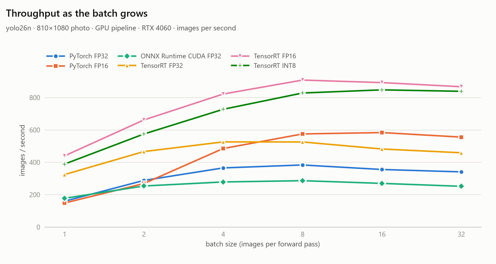
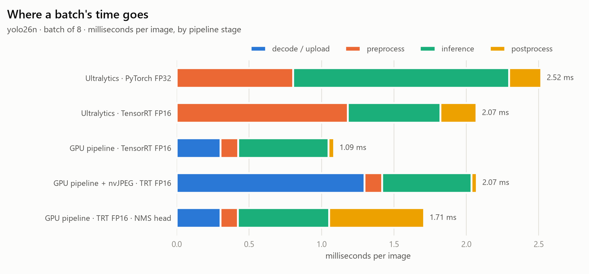
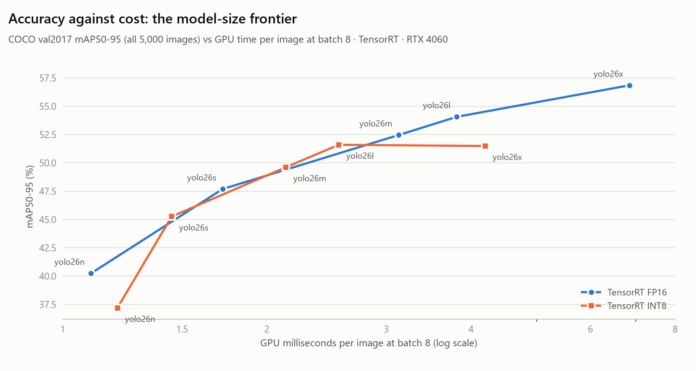
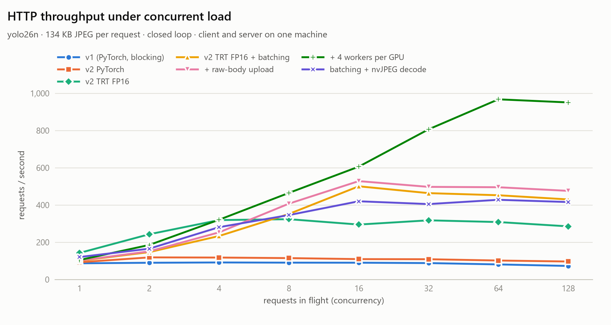
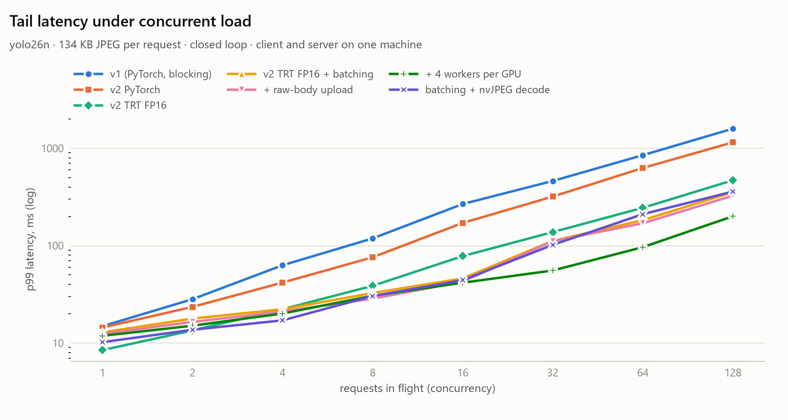

# Benchmark results

Generated by `tools/report.py` from the JSON in `results/`. Every number below was measured on the machine described at the end; nothing is quoted from elsewhere. Reproduce with the commands in the README.

## Runtime and precision

Same model (yolo26n), same photograph, same GPU pipeline; only the runtime and numeric precision change. Latency is one `predict_batch` call, measured on the host clock, with the image already decoded.

<picture>
  <source media="(prefers-color-scheme: dark)" srcset="results/batch-throughput.dark.png">
  
</picture>

| Runtime | b1 p50 ms | b1 p99 ms | b1 img/s | b8 img/s | b32 img/s | Peak img/s | VRAM added MB | First call ms (no warmup) |
|---|---|---|---|---|---|---|---|---|
| PyTorch FP32 | 6.11 | 10.54 | 160 | 384 | 341 | 384 (b8) | 1,229 | 275 |
| PyTorch FP16 | 6.66 | 8.49 | 148 | 575 | 556 | 584 (b16) | 911 | 1,162 |
| ONNX Runtime CUDA FP32 | 5.51 | 7.25 | 178 | 286 | 252 | 286 (b8) | 2,493 | 472 |
| TensorRT FP32 | 2.93 | 5.58 | 324 | 526 | 459 | 526 (b4) | 1,113 | 84 |
| TensorRT FP16 | 2.24 | 2.70 | 440 | 908 | 867 | 908 (b8) | 854 | 79 |
| TensorRT INT8 | 2.54 | 2.93 | 389 | 828 | 839 | 848 (b16) | 1,127 | 84 |
| TensorRT FP16 static b1 (CUDA graph) | 1.49 | 1.84 | 659 | – | – | 659 (b1) | 229 | 30 |

## Where the time goes

Per-stage device time from CUDA events (GPU pipeline) or the predictor's own timers (Ultralytics), divided by the batch size. *Wall* is the host-measured p50 per image, which includes host work the stage timers do not see.

<picture>
  <source media="(prefers-color-scheme: dark)" srcset="results/stages.dark.png">
  
</picture>

| Pipeline | decode / upload ms | preprocess ms | inference ms | postprocess ms | wall ms/img | img/s |
|---|---|---|---|---|---|---|
| Ultralytics · PyTorch FP32 | 0.000 | 0.804 | 1.491 | 0.222 | 2.688 | 370 |
| Ultralytics · TensorRT FP16 | 0.000 | 1.183 | 0.637 | 0.251 | 2.234 | 442 |
| GPU pipeline · TensorRT FP16 | 0.303 | 0.121 | 0.624 | 0.038 | 1.098 | 907 |
| GPU pipeline + nvJPEG · TRT FP16 | 1.298 | 0.120 | 0.617 | 0.038 | 2.086 | 479 |
| GPU pipeline · TRT FP16 · NMS head | 0.303 | 0.120 | 0.629 | 0.656 | 1.723 | 580 |

## Model size, precision and accuracy

Every YOLO26 size on TensorRT at FP16 and INT8. Accuracy is measured here, on all 5,000 COCO val2017 images through the same GPU pipeline the service runs - not quoted from a model card. INT8 was calibrated on 128 train2017 images (coco128), none of which are in the evaluation set.

<picture>
  <source media="(prefers-color-scheme: dark)" srcset="results/pareto.dark.png">
  
</picture>

| Model | Precision | mAP50-95 | mAP small | b1 p50 ms | b8 img/s | b32 img/s | VRAM added MB |
|---|---|---|---|---|---|---|---|
| yolo26n | FP16 | 40.2 | 19.8 | 2.24 | 908 | 870 | 928 |
| yolo26n | INT8 | 37.2 | 17.9 | 2.53 | 830 | 839 | 1,194 |
| yolo26s | FP16 | 47.7 | 30.2 | 2.71 | 581 | 559 | 1,207 |
| yolo26s | INT8 | 45.3 | 28.2 | 2.58 | 691 | 688 | 1,235 |
| yolo26m | FP16 | 52.5 | 35.8 | 4.19 | 320 | 315 | 1,719 |
| yolo26m | INT8 | 49.6 | 33.0 | 3.36 | 469 | 469 | 1,379 |
| yolo26l | FP16 | 54.1 | 36.7 | 5.39 | 262 | 256 | 1,807 |
| yolo26l | INT8 | 51.6 | 34.5 | 4.21 | 392 | 387 | 1,403 |
| yolo26x | FP16 | 56.9 | 40.6 | 8.61 | 146 | – | 1,367 |
| yolo26x | INT8 | 51.5 | 36.9 | 5.64 | 238 | – | 931 |

## The service under load

Real HTTP: each virtual client uploads the 134 KB sample JPEG (as multipart form data, or as the raw request body for the raw-body configurations), waits for the JSON answer, and sends the next. The load generator runs in 4 processes on the same machine as the server, so both compete for the same CPU - a conservative setup for the server. *Capacity @ SLO* is the highest throughput reached with p99 under the target and no request shed.

<picture>
  <source media="(prefers-color-scheme: dark)" srcset="results/service-throughput.dark.png">
  
</picture>

<picture>
  <source media="(prefers-color-scheme: dark)" srcset="results/service-p99.dark.png">
  
</picture>

| Configuration | c1 p50 ms | Peak req/s | Capacity @ p99≤50 ms | Capacity @ p99≤100 ms | Batch @ peak | GPU util @ peak % | Server CPU @ peak % | Ready in s |
|---|---|---|---|---|---|---|---|---|
| v1 (PyTorch, blocking) | 11.3 | 92 @ c4 | 90 | 92 | – | 37 | 97 | 3.3 |
| v2 PyTorch | 10.7 | 119 @ c2 | 119 | 119 | 1.0 | 38 | 132 | 2.5 |
| v2 TRT FP16 | 6.9 | 324 @ c8 | 324 | 324 | 1.0 | 58 | 220 | 2.5 |
| v2 TRT FP16 + batching | 9.9 | 500 @ c16 | 500 | 500 | 8.0 | 50 | 282 | 3.0 |
| + raw-body upload | 9.8 | 528 @ c16 | 528 | 528 | 8.0 | 54 | 282 | 3.0 |
| + 4 workers per GPU | 9.4 | 968 @ c64 | 606 | 968 | – | 91 | 881 | 7.2 |
| batching + nvJPEG decode | 8.1 | 428 @ c64 | 420 | 420 | 31.9 | 46 | 131 | 3.1 |

Every concurrency level

**v1: PyTorch FP32, blocking handler, no batching**

| Concurrency | req/s | p50 ms | p99 ms | mean batch | queue wait ms | GPU util % | server CPU % | 503s |
|---|---|---|---|---|---|---|---|---|
| 1 | 87 | 11.3 | 14.9 | – | – | 29 | 92 | 0 |
| 2 | 90 | 21.7 | 28.2 | – | – | 39 | 98 | 0 |
| 4 | 92 | 43.1 | 62.9 | – | – | 37 | 97 | 0 |
| 8 | 90 | 86.7 | 118.7 | – | – | 39 | 97 | 0 |
| 16 | 90 | 171.0 | 267.7 | – | – | 37 | 98 | 0 |
| 32 | 88 | 342.2 | 461.8 | – | – | 36 | 98 | 0 |
| 64 | 81 | 723.2 | 849.8 | – | – | 37 | 98 | 0 |
| 128 | 73 | 1,358.3 | 1,590.5 | – | – | 37 | 97 | 0 |

**v2: PyTorch FP32, no batching**

| Concurrency | req/s | p50 ms | p99 ms | mean batch | queue wait ms | GPU util % | server CPU % | 503s |
|---|---|---|---|---|---|---|---|---|
| 1 | 92 | 10.7 | 14.4 | 1.00 | 0.01 | 34 | 93 | 0 |
| 2 | 119 | 16.1 | 23.5 | 1.00 | 4.02 | 38 | 132 | 0 |
| 4 | 118 | 33.4 | 41.8 | 1.00 | 20.81 | 41 | 134 | 0 |
| 8 | 115 | 68.5 | 76.0 | 1.00 | 55.78 | 41 | 132 | 0 |
| 16 | 110 | 139.3 | 171.1 | 1.00 | 128.45 | 40 | 133 | 0 |
| 32 | 109 | 281.6 | 319.1 | 1.00 | 265.97 | 41 | 131 | 0 |
| 64 | 102 | 576.8 | 627.8 | 1.00 | 551.75 | 41 | 131 | 0 |
| 128 | 97 | 1,136.7 | 1,150.8 | 1.00 | 1,059.14 | 41 | 137 | 0 |

**v2: TensorRT FP16, no batching**

| Concurrency | req/s | p50 ms | p99 ms | mean batch | queue wait ms | GPU util % | server CPU % | 503s |
|---|---|---|---|---|---|---|---|---|
| 1 | 142 | 6.9 | 8.5 | 1.00 | 0.01 | 30 | 91 | 0 |
| 2 | 243 | 8.0 | 13.5 | 1.00 | 0.17 | 46 | 165 | 0 |
| 4 | 319 | 12.1 | 22.2 | 1.00 | 4.09 | 53 | 211 | 0 |
| 8 | 324 | 23.9 | 38.7 | 1.00 | 16.44 | 58 | 220 | 0 |
| 16 | 295 | 50.5 | 78.1 | 1.00 | 44.38 | 53 | 203 | 0 |
| 32 | 318 | 96.8 | 137.8 | 1.00 | 90.51 | 58 | 217 | 0 |
| 64 | 308 | 198.0 | 244.7 | 1.00 | 191.65 | 53 | 224 | 0 |
| 128 | 285 | 417.5 | 469.2 | 1.00 | 402.55 | 52 | 219 | 0 |

**v2: TensorRT FP16, dynamic batching (up to 32, 2 ms)**

| Concurrency | req/s | p50 ms | p99 ms | mean batch | queue wait ms | GPU util % | server CPU % | 503s |
|---|---|---|---|---|---|---|---|---|
| 1 | 100 | 9.9 | 12.9 | 1.00 | 2.57 | 25 | 70 | 0 |
| 2 | 147 | 13.3 | 17.8 | 2.00 | 2.67 | 39 | 95 | 0 |
| 4 | 234 | 16.9 | 22.2 | 3.89 | 2.88 | 37 | 133 | 0 |
| 8 | 352 | 22.6 | 32.6 | 6.00 | 2.97 | 41 | 195 | 0 |
| 16 | 500 | 31.1 | 46.1 | 7.96 | 3.42 | 50 | 282 | 0 |
| 32 | 464 | 67.0 | 111.8 | 15.93 | 11.70 | 49 | 277 | 0 |
| 64 | 452 | 135.7 | 182.6 | 31.54 | 31.12 | 50 | 318 | 0 |
| 128 | 430 | 280.9 | 354.6 | 31.73 | 171.90 | 46 | 298 | 0 |

**v2: TensorRT FP16, batching, raw-body upload**

| Concurrency | req/s | p50 ms | p99 ms | mean batch | queue wait ms | GPU util % | server CPU % | 503s |
|---|---|---|---|---|---|---|---|---|
| 1 | 102 | 9.8 | 12.4 | 1.00 | 2.60 | 25 | 70 | 0 |
| 2 | 151 | 13.0 | 16.5 | 2.00 | 2.77 | 37 | 95 | 0 |
| 4 | 253 | 15.6 | 21.1 | 3.93 | 2.81 | 40 | 137 | 0 |
| 8 | 407 | 18.9 | 28.5 | 4.80 | 2.75 | 42 | 211 | 0 |
| 16 | 528 | 29.3 | 42.6 | 7.97 | 3.57 | 54 | 282 | 0 |
| 32 | 498 | 62.5 | 111.2 | 15.99 | 11.48 | 50 | 320 | 0 |
| 64 | 496 | 124.0 | 169.8 | 31.77 | 31.05 | 50 | 349 | 0 |
| 128 | 476 | 253.9 | 325.8 | 31.80 | 158.20 | 50 | 357 | 0 |

**v2: TensorRT FP16, batching, raw body, 4 workers on one GPU**

| Concurrency | req/s | p50 ms | p99 ms | mean batch | queue wait ms | GPU util % | server CPU % | 503s |
|---|---|---|---|---|---|---|---|---|
| 1 | 105 | 9.4 | 11.9 | – | – | 25 | 68 | 0 |
| 2 | 186 | 10.8 | 15.1 | – | – | 37 | 140 | 0 |
| 4 | 321 | 12.2 | 20.1 | – | – | 42 | 197 | 0 |
| 8 | 465 | 16.3 | 30.5 | – | – | 81 | 409 | 0 |
| 16 | 606 | 26.0 | 41.6 | – | – | 91 | 626 | 0 |
| 32 | 806 | 39.7 | 55.6 | – | – | 95 | 775 | 0 |
| 64 | 968 | 62.7 | 96.5 | – | – | 91 | 881 | 0 |
| 128 | 951 | 124.3 | 200.2 | – | – | 93 | 930 | 0 |

**v2: TensorRT FP16, batching, nvJPEG decode**

| Concurrency | req/s | p50 ms | p99 ms | mean batch | queue wait ms | GPU util % | server CPU % | 503s |
|---|---|---|---|---|---|---|---|---|
| 1 | 121 | 8.1 | 10.2 | 1.00 | 2.71 | 21 | 64 | 0 |
| 2 | 166 | 12.0 | 13.7 | 2.00 | 2.71 | 37 | 74 | 0 |
| 4 | 281 | 13.7 | 17.1 | 2.41 | 3.36 | 37 | 106 | 0 |
| 8 | 346 | 22.5 | 30.4 | 4.00 | 5.39 | 38 | 120 | 0 |
| 16 | 420 | 37.3 | 44.3 | 8.00 | 8.93 | 39 | 130 | 0 |
| 32 | 405 | 76.2 | 101.9 | 17.08 | 11.20 | 37 | 117 | 0 |
| 64 | 428 | 144.8 | 210.6 | 31.85 | 46.19 | 46 | 131 | 0 |
| 128 | 416 | 291.1 | 359.6 | 31.90 | 189.82 | 41 | 132 | 0 |

## Capacity planning

From the measured service capacity of **606 requests/s per GPU at p99 ≤ 50 ms** (+ 4 workers per GPU: TensorRT FP16, dynamic batching, one RTX 4060).

**Camera streams per GPU** (one detection per frame):

| Frame rate | Streams per GPU |
|---|---|
| 5 fps | 121 |
| 15 fps | 40 |
| 30 fps | 20 |

**Cost per million images** at a hypothetical all-in GPU-hour price. Substitute your own; the arithmetic is `price / (throughput × 3600) × 10⁶`, at sustained full load:

| GPU-hour price | Per million images | Images per GPU-day |
|---|---|---|
| $0.25 | $0.115 | 52.4 M |
| $0.75 | $0.344 | 52.4 M |
| $2.00 | $0.917 | 52.4 M |

**Energy ceiling.** This board does not report power draw through NVML, so energy is bounded rather than measured: at its 130 W power limit and 606 images/s, at most **215 mJ per image** (59.59 Wh per thousand).

**Autoscaling target.** `deploy/k8s/observability.yaml` runs four single-worker replicas per GPU and scales on request rate, with a per-replica target of 70% of a quarter of this capacity: **106 req/s**.

## Accuracy detail (COCO val2017, 5,000 images)

Conventional evaluation settings: confidence ≥ 0.001, ≤ 300 detections, official pycocotools evaluator. *End-to-end img/s* is the whole offline job - JPEG decode on 8 CPU threads overlapped with the GPU, batch 32 - which is the figure that sizes a batch job over an image archive.

| Configuration | mAP50-95 | mAP50 | mAP small | mAP large | End-to-end img/s |
|---|---|---|---|---|---|
| yolo26n PyTorch FP32 (Ultralytics predictor) | 40.26 | 55.78 | 19.77 | 58.31 | 235 |
| yolo26n PyTorch FP32 (GPU pipeline) | 40.26 | 55.79 | 19.77 | 58.31 | 318 |
| yolo26n PyTorch FP32, one-to-many head + NMS (GPU pipeline) | 39.62 | 56.61 | 19.37 | 57.91 | 289 |
| yolo26n TensorRT FP32 | 40.26 | 55.79 | 19.78 | 58.32 | 413 |
| yolo26n TensorRT FP16 | 40.24 | 55.79 | 19.76 | 58.26 | 676 |
| yolo26n TensorRT INT8 | 37.19 | 52.96 | 17.89 | 52.51 | 767 |
| yolo26s TensorRT FP16 | 47.69 | 64.30 | 30.18 | 64.20 | 493 |
| yolo26s TensorRT INT8 | 45.26 | 61.92 | 28.20 | 60.88 | 662 |
| yolo26m TensorRT FP16 | 52.46 | 69.66 | 35.76 | 68.63 | 306 |
| yolo26m TensorRT INT8 | 49.61 | 66.54 | 32.98 | 66.93 | 478 |
| yolo26l TensorRT FP16 | 54.07 | 71.15 | 36.74 | 69.84 | 255 |
| yolo26l TensorRT INT8 | 51.60 | 68.32 | 34.51 | 67.42 | 398 |
| yolo26x TensorRT FP16 | 56.85 | 74.04 | 40.64 | 72.98 | 150 |
| yolo26x TensorRT INT8 | 51.49 | 68.77 | 36.89 | 70.38 | 247 |

## JPEG decode: CPU threads or nvJPEG?

Decoding the 134 KB, 810×1080 sample, in isolation.

| Decoder | img/s |
|---|---|
| OpenCV, 1 thread | 407 |
| OpenCV, 4 threads | 1,101 |
| OpenCV, 8 threads | 1,680 |
| OpenCV, 16 threads | 2,068 |
| nvJPEG (CUDA), batch 1 | 618 |
| nvJPEG (CUDA), batch 8 | 782 |
| nvJPEG (CUDA), batch 32 | 815 |

## Without a GPU

The same yolo26n on the host CPU through the stock predictor - the fallback when no GPU is present, and the denominator of the GPU's speed-up.

| Configuration | Batch | p50 ms | p99 ms | img/s |
|---|---|---|---|---|
| CPU PyTorch FP32 | 1 | 20.5 | 22.5 | 50.9 |
| CPU PyTorch FP32 | 8 | 114.6 | 119.3 | 69.7 |
| CPU ONNX Runtime FP32 | 1 | 14.4 | 16.0 | 71.4 |
| CPU ONNX Runtime FP32 | 8 | 105.5 | 111.4 | 75.9 |

## Test machine

|  |  |
|---|---|
| gpu | NVIDIA GeForce RTX 4060 |
| gpu_memory_gb | 8.0 |
| gpu_sm | 8.9 |
| gpu_sms | 24 |
| driver | 610.88 |
| cpu | Intel(R) Core(TM) i7-14700F |
| cpu_threads | 28 |
| os | Windows 11 |
| python | 3.13.15 |
| torch | 2.15.0+cu132 |
| cuda | 13.2 |
| cudnn | 92600 |
| tensorrt | 11.4.0.106 |
| onnxruntime | 1.32.0 |
| ultralytics | 8.4.215 |
| cv2 | 5.1.0 |
| fastapi | 0.163.1 |
| timestamp | 2026-11-17T18:30:32+0200 |
